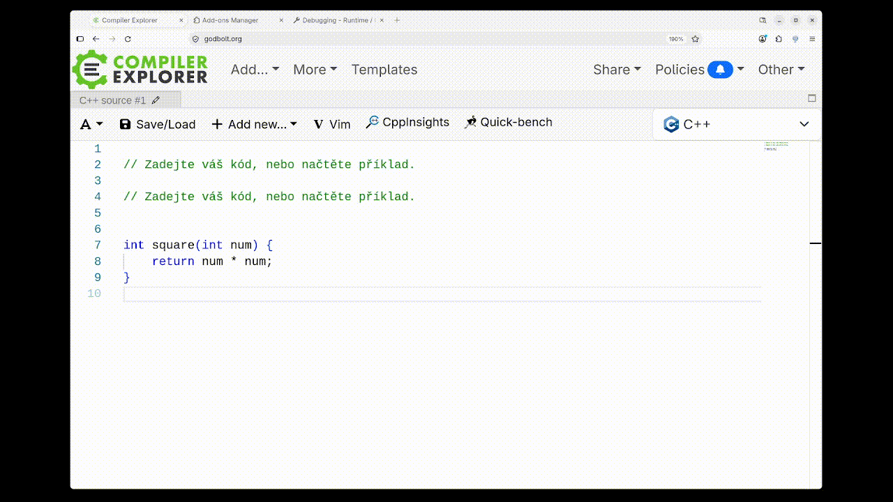

# WebTranslatePlace

Translate selected drafts and email text, with additional Discord message translation, using
[Tomáš Mark's translation-api](https://github.com/tomasmark79/translation-api).
WebTranslatePlace is the browser and Thunderbird client for that server; the
server and language model are installed separately.



## Features

- **Selected drafts:** translate selected text in text/search inputs, textareas
  and editable content. Only the selection is replaced; messages are never sent
  automatically. Changed drafts or selections are left untouched.
- **Thunderbird:** replace selected text while composing, or display a translation
  in a separate panel while reading. Stored messages remain unchanged.
- **Settings and history:** configure the server, two TranslatePlace target
  languages and a separate Discord target. Recover, copy or delete original
  selections and completed translations from local history.
- **Additional Discord translation:** click the translation icon next to a
  message block to translate its messages. Toggle originals and retry failed
  messages as needed; each message gets its own translation.
  Discord translation can be enabled or disabled in the popup.

## Requirements

- A running [translation-api](https://github.com/tomasmark79/translation-api),
  including its Ollama/model setup. Follow that project's installation guide.
- Chrome/Chromium **107+** (including Edge and Brave), Firefox **142+**, Thunderbird
  **128+**, or one of the experimental targets below.
- **Build tools:** Python 3. Safari packaging also requires macOS and Xcode.

Safari and GNOME Web are prepared build targets requiring live verification.
GNOME Web testing encountered crashes and messaging failures; working translation
is not confirmed. See [Epiphany limitations](docs/epiphany.md).

## Installation

Build from the project directory:

```bash
python3 scripts/build.py                 # all five targets
python3 scripts/build.py chrome firefox  # selected targets
```

| Target | Installation |
| --- | --- |
| Chrome/Chromium | Open `chrome://extensions/`, enable **Developer mode**, choose **Load unpacked** and select `dist/chrome/`. |
| Firefox | In `about:debugging#/runtime/this-firefox`, choose **Load Temporary Add-on** and select `dist/firefox/manifest.json`. Temporary installation ends when Firefox exits; permanent installation requires Mozilla signing. |
| Thunderbird | In **Add-ons and Themes**, choose **Install Add-on From File** from the gear menu and select `dist/webtranslateplace-thunderbird-0.1.0.xpi`. |
| Safari | Run `bash scripts/package-safari.sh`, build/run `SafariProject/` in Xcode and enable the extension with access to the desired sites. The generated ZIP is not directly installable. |
| GNOME Web (experimental) | Enable experimental WebExtensions support and import `dist/webtranslateplace-epiphany-0.1.0.xpi` through the extension manager. |

Reload pages or reopen Thunderbird message/compose windows after installing or
updating. Disable DiMeTrans/CzEn Composer on the same pages to avoid duplicate
icons and shortcut conflicts; their settings and history are not imported.

Firefox now uses `webtranslateplace@digitalspace.name`. Installations using the
previous `webtranslateplace@tomasmark79` ID are separate add-ons; their settings
and history are not migrated automatically.

## Usage

Start translation-api, then open the extension popup. **Translation API URL**
defaults to `http://127.0.0.1:5001`. Enter the server's base URL without `/translate`
and press **Save**. Selection and Discord translation use this address.

Source language is detected automatically. **TranslatePlace language 1** defaults
to English, **language 2** to Czech, and **Discord target language** to Czech.
Select text, then invoke the desired TranslatePlace command:

| Application | Language 1 | Language 2 | macOS language 1 | macOS language 2 |
| --- | --- | --- | --- | --- |
| Firefox | **Ctrl+Alt+E** | **Ctrl+Alt+W** | **Command+Option+E** | **Command+Option+W** |
| Other browsers | **Shift+Alt+E** | **Shift+Alt+W** | **Shift+Option+E** | **Shift+Option+W** |
| Thunderbird | **Ctrl+Alt+E** | **Ctrl+Alt+W** | **Command+Option+E** | **Command+Option+W** |

Change bindings through `chrome://extensions/shortcuts` or **Manage Extension
Shortcuts** in Firefox/Thunderbird. The popup displays the assigned bindings when
supported. In Thunderbird, select text in the message body; subject and recipient
fields are outside this integration.

Selected drafts and email selections are limited to 10,000 characters. Keep the
editor focused and the draft and selection unchanged until replacement completes.

Use **Show history** in the popup to recover original draft selections and their
completed translations. This includes Thunderbird compose selections; translations
while reading email appear only in the separate panel and are not saved to history.
**History limit** retains 1–1,000 entries (default: 50); lowering it immediately
removes the oldest excess entries.

Only text explicitly requested for translation is sent to your configured server.
There is no analytics or telemetry. Original selections and completed translations
are stored locally, without encryption or sync, and removed on uninstall. Website
access permissions allow selection translation and connections to the configured
API; browser-granted site restrictions still apply.

For the additional Discord feature, click a translation icon to translate its
message block; click again to toggle originals. Selection translation also works
in Discord's composer.

## Development

Edit `src/` and `manifests/`, then rebuild; `dist/` is generated and ignored by Git.
Shared metadata lives in `manifests/base.json`, with target-specific overlays.
Packages contain runtime assets and LICENSE, with fixed ZIP metadata for
reproducible builds. The VS Code workspace includes a build task.

```bash
node --test tests/*.test.cjs
WEBTRANSLATEPLACE_API_NAMESPACE=browser node --test tests/*.test.cjs
python3 -m unittest discover -s tests -p 'test_*.py'
python3 scripts/build.py
npx --yes web-ext lint --source-dir dist/firefox --warnings-as-errors
```

With translation-api running, `node tests/live-translation.cjs chrome` (or
`firefox`) checks real HTTP translations with simulated extension origins.
Set `WEBTRANSLATEPLACE_API_URL` to test another address. See the server's
[HTTP API documentation](https://github.com/tomasmark79/translation-api/blob/main/docs/api.md)
for the job submission and polling protocol.

Automated checks do not verify browser UI behavior. Before release, test shortcuts,
selection replacement, changed-draft protection, history, permissions and clipboard
in each supported application. Thunderbird's live mail, focus and undo behavior
also require verification. Finally, check the additional Discord translation and
toggling of originals.

## Troubleshooting

- **Server unavailable:** check `http://127.0.0.1:5001/health` (or your configured
  server) for `"status": "ready"`, then verify Ollama and the model are running.
- **Shortcut does nothing:** check its assigned binding and site access, reload
  the page and select editable text. Protected browser pages cannot be translated.
  For local files in Chromium, enable **Allow access to file URLs**.
- **Translation takes time:** jobs wait up to fifteen minutes, including queue
  time; individual HTTP requests time out after fifteen seconds.

Report issues in the [issue tracker](https://github.com/tomasmark79/WebTranslatePlace/issues)
with the application version and reproduction steps. Remove private text from logs.

## License

Copyright © 2026 Tomáš Mark. Licensed under **GPL-3.0-or-later**.
See [LICENSE](LICENSE).
